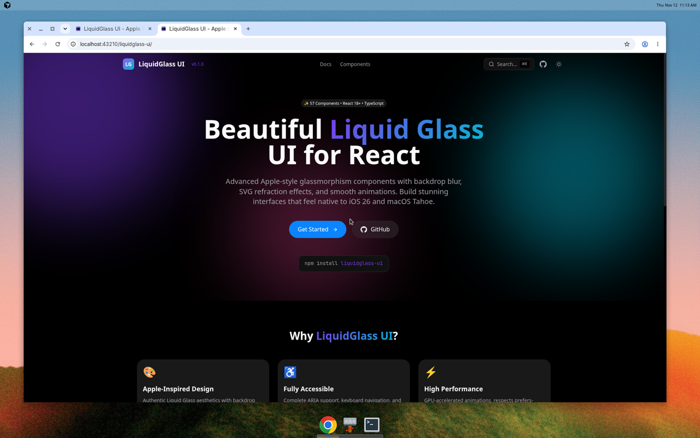
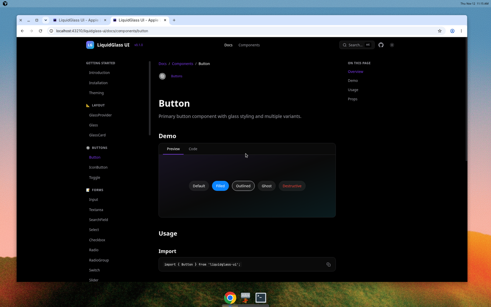
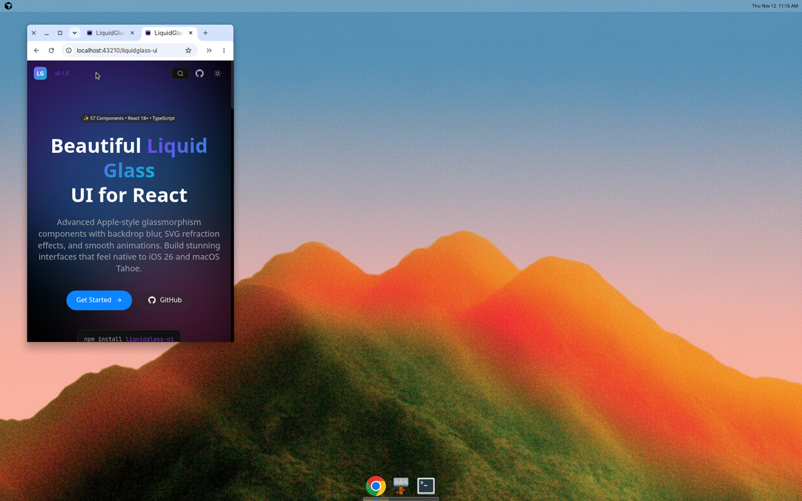

# LiquidGlass UI

> Advanced Apple Liquid Glass (iOS 26 / macOS Tahoe) UI component library for React

[](https://www.npmjs.com/package/@nkanish/liquidglass-ui)
[](LICENSE)

## What is LiquidGlass UI?

LiquidGlass UI brings Apple's beautiful Liquid Glass design language to the web. It features authentic glass effects with backdrop blur, SVG refraction/lensing, and smooth animations that respond to user interaction.

## Screenshots

### Landing Page (Dark Theme)


### Component Documentation


### Mobile View


## Key Features

- **57 Components** - Comprehensive UI toolkit with 41 component files
- **Authentic Glass Effect** - Backdrop blur with SVG displacement filters
- **Dark Mode** - Automatic light/dark theme switching
- **Accessible** - Full ARIA support and keyboard navigation
- **TypeScript** - Complete type definitions
- **Zero Dependencies** - Only React as peer dependency
- **86 Tests** - Comprehensive test coverage

## Quick Start

```bash
npm install @nkanish/liquidglass-ui
```

```tsx
import { GlassProvider, Button, GlassCard } from '@nkanish/liquidglass-ui';
import '@nkanish/liquidglass-ui/styles.css';

function App() {
  return (
    <GlassProvider>
      <GlassCard>
        <h1>Hello, Glass!</h1>
        <Button variant="filled">Click me</Button>
      </GlassCard>
    </GlassProvider>
  );
}
```

## Documentation

See the full documentation and live demos: [Documentation Site](https://nitinkanish.github.io/liquidglass-ui/)

## Repository Structure

```
liquidglass-ui/
├── packages/
│   └── liquidglass-ui/    # The npm package
├── apps/
│   └── docs/              # Documentation site
├── docs/
│   ├── research.md        # Research notes
│   └── PUBLISHING.md      # Publishing guide
└── .github/
    └── workflows/         # CI/CD workflows
```

## Development

```bash
# Install dependencies
pnpm install

# Start docs dev server
pnpm dev

# Build library
pnpm build:lib

# Run tests
pnpm test
```

## Component List

### Layout
- GlassProvider, Glass, GlassCard

### Buttons
- Button, IconButton, Toggle

### Forms
- Input, Textarea, SearchField, Select, Checkbox, Radio, Switch, Slider, DatePicker

### Navigation
- TabBar, SegmentedControl, Tabs, Navbar, Sidebar, Dock, Carousel

### Overlays
- Modal, Sheet, Menu, Tooltip, Drawer, Popover, ContextMenu, CommandPalette

### Feedback
- Toast, Alert, Progress, Spinner

### Data Display
- Badge, Avatar, Chip, Accordion, Separator, Skeleton

### Actions
- FloatingActionButton (FAB)

## Browser Support

- Chrome 76+
- Firefox 103+
- Safari 9+
- Edge 79+

## License

MIT License - Copyright (c) 2026 Nitin Kanish, Debugged Pro

---

**Developed by Nitin Kanish, Debugged Pro**
