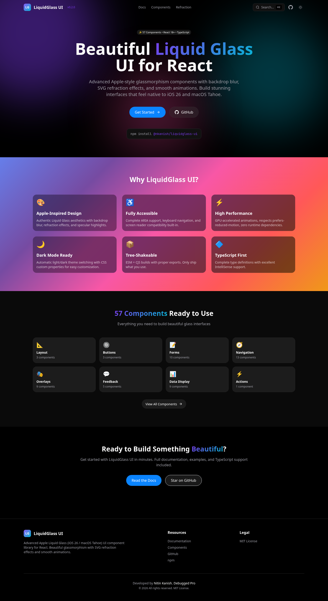
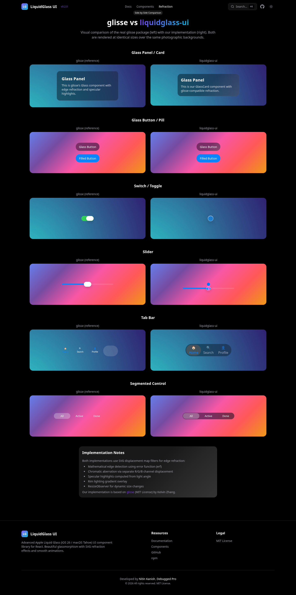
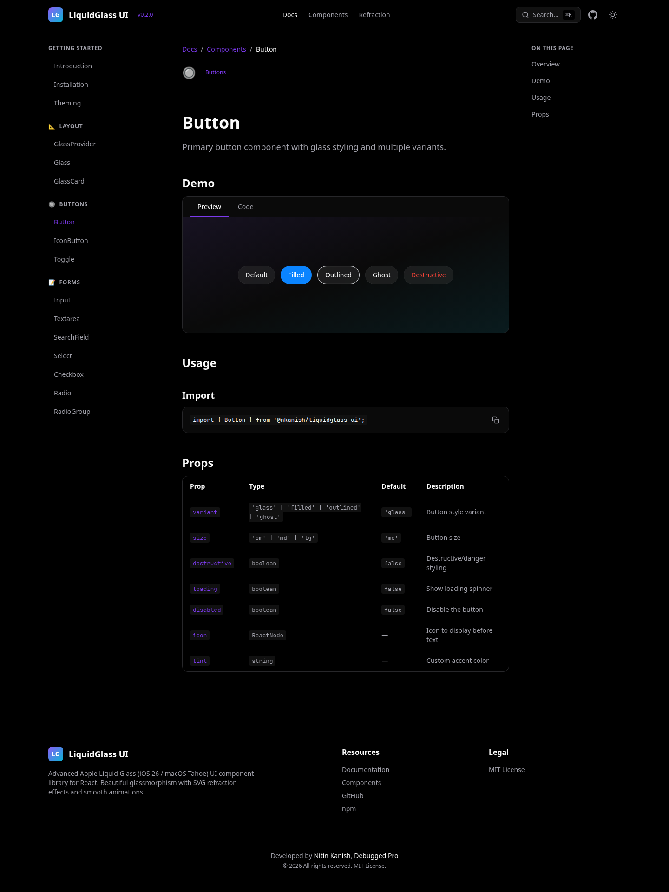

# LiquidGlass UI

> Advanced Apple Liquid Glass (iOS 26 / macOS Tahoe) UI component library for React

[](https://www.npmjs.com/package/@nkanish/liquidglass-ui)
[](LICENSE)

## What is LiquidGlass UI?

LiquidGlass UI brings Apple's beautiful Liquid Glass design language to the web. It features authentic glass effects with backdrop blur, SVG refraction/lensing, and smooth animations that respond to user interaction.

## Screenshots

### Landing Page with Refraction Effect


### Side-by-Side Comparison with glisse


### Component Documentation


## Key Features

- **57 Components** - Comprehensive UI toolkit with 41 component files
- **Authentic Glass Effect** - Glisse-compatible SVG refraction with edge lensing, chromatic aberration, and specular highlights
- **Dark Mode** - Automatic light/dark theme switching
- **Accessible** - Full ARIA support and keyboard navigation
- **TypeScript** - Complete type definitions
- **Zero Dependencies** - Only React as peer dependency
- **86 Tests** - Comprehensive test coverage

## Glass Refraction

The glass refraction effect is based on [glisse](https://github.com/0kzh/glisse) (MIT License) by Kelvin Zhang. Enable it on any Glass component:

```tsx
<Glass refraction refractionDepth={8} refractionDome={4} shine={0.3}>
  Content with edge refraction effect
</Glass>
```

## Apple Liquid Glass

Every `.lg-glass` surface (all components) shares one Liquid Glass material, tuned to Apple's public guidance (HIG *Materials*, WWDC25 *Meet Liquid Glass* / *Get to know the new design system*):

| Apple behaviour | Where it lives |
| --- | --- |
| Lensing / refraction at the edges | SVG displacement lens on the backdrop (`--lg-filter`, Chromium), applied automatically to every glass surface by `GlassProvider` (`autoLens`) |
| Chromatic aberration | `aberration` prop / `dispersion` option (0-1) |
| Specular highlights that follow light | `--lg-light-angle` rim; `GlassProvider config={{ light: 'pointer' \| 'motion' \| 'static' }}`; per-element `specular="pointer"` |
| Regular vs clear | `variant="clear"` / `effect="clear"`, plus `dim` for legibility over bright media |
| Tint | `tintColor` (keeps blur and white rim, unlike `tint`) |
| Adaptive light/dark | `colorScheme="light" \| "dark"` scopes glass tokens on any surface |
| Fluid, interactive states | glass swells and glows on press (`--lg-press-scale`), `elasticity` stretches toward the pointer |
| Merging glass | `<GlassContainer spacing={20}>` joins neighbouring glass with a liquid neck |
| Concentric corners | use `border-radius: calc(parent - inset)` |
| Accessibility | Reduce Transparency removes blur + lens (opaque surface), Reduce Motion removes press/bounce/elastic, `prefers-contrast: more` strengthens edges |
| Capability tiers | `getGlassSupport()` returns `lens` (Chromium), `material` (Safari/Firefox), or `solid` |

```tsx
<GlassProvider config={{ light: 'pointer' }}>
  <Glass effect="clear" dim tintColor="#0a84ff" elasticity={0.15} interactive>
    Clear, tinted, interactive glass
  </Glass>
  <GlassContainer spacing={24} gap={10}>
    <IconButton aria-label="One" icon={...} />
    <IconButton aria-label="Two" icon={...} />
  </GlassContainer>
</GlassProvider>
```

**Honest limits of the web.** Browsers cannot sample the pixels behind a surface, so the native adaptive light/dark switch is approximated with `colorScheme`. Real backdrop refraction needs SVG filters inside `backdrop-filter`, which only Chromium supports; Safari and Firefox get the frosted material with the same specular rim, tint and shadows. Native glass also merges with a shader; `GlassContainer` is an approximation.

## Quick Start

```bash
npm install @nkanish/liquidglass-ui
```

```tsx
import { GlassProvider, Button, GlassCard } from '@nkanish/liquidglass-ui';
import '@nkanish/liquidglass-ui/styles.css';

function App() {
  return (
    <GlassProvider>
      <GlassCard>
        <h1>Hello, Glass!</h1>
        <Button variant="filled">Click me</Button>
      </GlassCard>
    </GlassProvider>
  );
}
```

## Documentation

See the full documentation and live demos: [Documentation Site](https://liquidglass-ui-docs.vercel.app/)

## Repository Structure

```
liquidglass-ui/
├── packages/
│   └── liquidglass-ui/    # The npm package
├── apps/
│   └── docs/              # Documentation site
├── docs/
│   ├── research.md        # Research notes
│   └── PUBLISHING.md      # Publishing guide
└── .github/
    └── workflows/         # CI/CD workflows
```

## Development

```bash
# Install dependencies
pnpm install

# Start docs dev server
pnpm dev

# Build library
pnpm build:lib

# Run tests
pnpm test
```

## Component List

### Layout
- GlassProvider, Glass, GlassCard

### Buttons
- Button, IconButton, Toggle

### Forms
- Input, Textarea, SearchField, Select, Checkbox, Radio, Switch, Slider, DatePicker

### Navigation
- TabBar, SegmentedControl, Tabs, Navbar, Sidebar, Dock, Carousel

### Overlays
- Modal, Sheet, Menu, Tooltip, Drawer, Popover, ContextMenu, CommandPalette

### Feedback
- Toast, Alert, Progress, Spinner

### Data Display
- Badge, Avatar, Chip, Accordion, Separator, Skeleton

### Actions
- FloatingActionButton (FAB)

## Browser Support

- Chrome 76+ / Edge 79+: full material **plus** backdrop lens refraction
- Safari and Firefox 103+: frosted material, specular rim, tint, press states (no backdrop refraction)
- Without `backdrop-filter`: opaque surface fallback

## License

MIT License - Copyright (c) 2026 Nitin Kanish, Debugged Pro

---

**Developed by Nitin Kanish, Debugged Pro**
